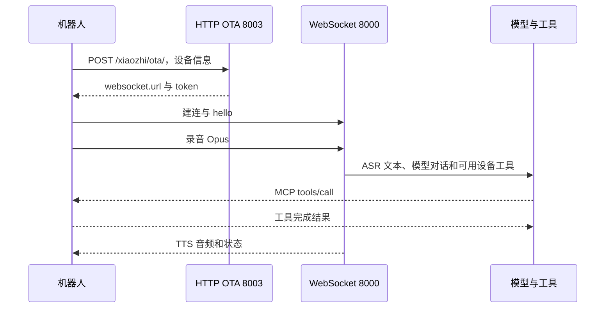

# 后端结构和两端接口

## 组件

- `main/xiaozhi-server/`：Python asyncio 服务，处理音频、ASR、模型、TTS、工具调用、OTA 发现。课程入门运行这一项。
- `main/manager-api/`：Java 管理 API，进阶学习设备、用户、模型配置及数据库。
- `main/manager-web/`：Vue 管理界面，配合管理 API 使用。
- `main/manager-mobile/`、`main/digital-human/`：保留的其它上游客户端/数字人内容。
- `docs/Deployment.md`、`docs/Deployment_all.md`：分别为单服务和完整管理栈部署说明。

完整管理栈的人设和模型由管理 API 提供；课程生成的配置关闭该配置入口，使用本地 YAML，不能同时把两种方式当成配置来源。

## 连接流程

OTA 在这里首先用于发现服务端，不要求每次都下载固件。不要把 HTTP 8003 与语音 WebSocket 8000 混用。电脑地址改变时，重新生成/调整后端地址，并更新设备配网中保存的 OTA 或重新编译默认值。

后端 `config/config_loader.py` 合并 `config.yaml` 和 `data/.config.yaml`，后者优先；课程配置仅覆盖必要项。其余如 ASR 模型目录、EdgeTTS 音色沿用上游默认值。模型密钥只在学生私有配置中填写。

设备 MCP 服务位于固件内。后端发现 `self.otto.laugh`、`self.otto.laugh_walk` 等工具，再由支持工具调用的模型选择调用。组合工具在设备本地同时启动音频和动作；服务端顺序调用两个独立工具不会产生重叠执行。

BOOT 发送 abort 后继续 listen/start。语音“停下”由本地 MultiNet 路径处理动作，不依赖云端识别和模型选择；喇叭干扰下的实际识别率需实测。

## 与 Otto Master 的关系

本课程整合的是标准小智后端，通过 OTA + WebSocket 连设备。Wiki 提到的 master.local、专用发现/认证、多机编排 Otto Master 通道没有在此课程中实现。固件板级已有的动作 WebSocket 调试代码也不等同于那套专用协议。

## 调试顺序

1. 后端启动：先解决缺依赖、模型文件或 API 配置问题。
2. 用根目录 probe_ota.py 检查下发地址，确认没有 localhost、0.0.0.0 或容器内部地址。
3. 串口确认固件实际使用的 OTA 地址和网络连接；已有配网页 NVS 覆盖优先。
4. WebSocket 连接成功后再测试问答，随后测试 MCP 工具。
5. 机器人会说但不动时检查模型是否真的调用设备工具；用两端日志区分“口头说已做”和收到 tools/call。

不把网络错误、模型报错和串口断线解释成“听不懂用户”。
